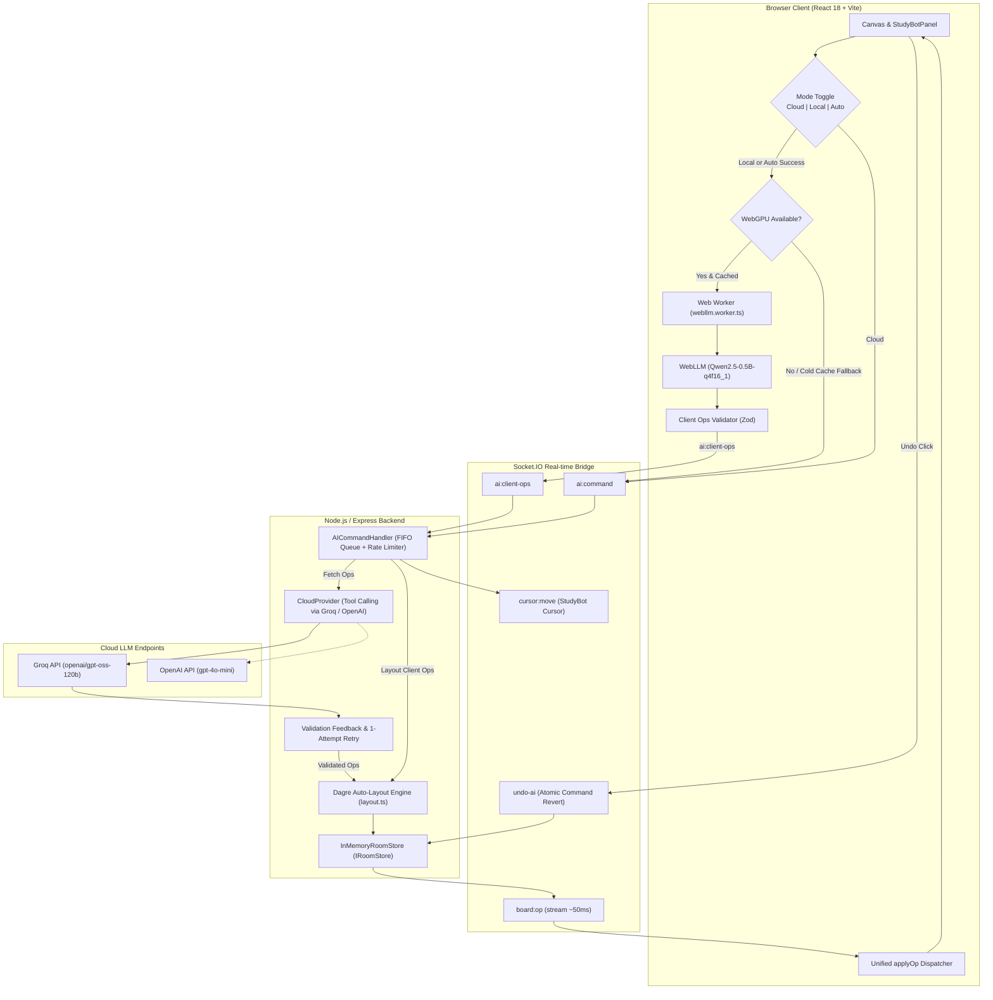

<p align="center">
  
  
  
  
  
  
  
</p>

<h1 align="center">📚 StudySync</h1>

<p align="center">
  <strong>A real-time collaborative whiteboard with integrated video conferencing &amp; StudyBot AI diagram agent for virtual study sessions</strong>
</p>

<p align="center">
  <a href="#-overview">Overview</a> •
  <a href="#-key-features">Key Features</a> •
  <a href="#-studybot-ai-diagram-agent">StudyBot AI</a> •
  <a href="#-unified-diagram-group-dragging">Diagram Dragging</a> •
  <a href="#-smart-non-overlapping-diagram-placement">Smart Placement</a> •
  <a href="#-benchmark--evaluation-cloud-vs-local">Benchmark</a> •
  <a href="#-deployment-guide">Deployment</a> •
  <a href="#-installation--setup">Setup</a>
</p>

---

## 🎯 Overview

**StudySync** is a full-featured real-time collaborative whiteboard platform tailored for remote study groups, classrooms, and distributed engineering teams. It pairs an infinite drawing canvas and integrated Jitsi video chat with **StudyBot** — an AI-powered diagramming collaborator that transforms natural language prompts into clean, auto-laid-out technical diagrams on the shared canvas.

StudyBot features a **hybrid dual-engine architecture**:
1. **Cloud LLM (Groq / OpenAI)**: Sub-second diagram generation via structured tool-calling.
2. **Local WebLLM (WebGPU)**: 100% private, on-device quantized model (`Qwen2.5-0.5B`) running inside a background Web Worker without blocking the 60 FPS canvas interface.

---

## ✨ Key Features

### 🎨 Infinite Drawing Canvas
- **Realistic Brushes & Pens** — Ballpoint, felt-tip, gel, fountain pens (pressure-sensitive), plus watercolor, marker, and pencils (HB, 2B, 4B).
- **Geometric Shapes** — Rectangles, circles, diamonds, triangles, hexagons, stars, hearts, arrows, and lines with custom fills and stroke widths.
- **Text & Annotations** — In-place text editor with custom fonts, alignment, and auto-sizing.
- **Eraser Modes** — Element-level precision eraser preserving geometrical shapes.
- **Canvas Navigation** — Smooth zoom (25% to 400%), two-finger touch gestures, pan, grid overlay, and lined paper backgrounds.

### 🤝 Real-Time Collaboration
- **WebSocket Synchronization** — Instant multi-user stroke and element synchronization via Socket.io.
- **Live User Cursors** — Colored cursors showing peer activity and real-time cursor positions.
- **Room Code System** — Create or join private study rooms instantly without mandatory registration.
- **Integrated Video Conferencing** — Embedded Jitsi Meet video panel with mic, camera, and layout controls.

### 🤖 StudyBot AI Diagram Agent
- **No Pixel Coordinates from LLMs** — LLMs strictly generate semantic graph topology (`add_node`, `add_edge`, `add_text`, `highlight`); layout geometry is computed deterministically.
- **Dagre Auto-Layout Engine** — Computes node dimensions, rank assignments, and spline edge trajectories mathematically.
- **Live Animated Cursor Drawing** — StudyBot joins the room as a named participant, moving its animated cursor as it draws nodes and edges one-by-one with ~50ms stepping.
- **Self-Healing Schema Validation** — Zod schema validation traps malformed tool calls and feeds errors back for automatic 1-attempt recovery.
- **Single-Click "Undo AI"** — Every AI generation is tagged with an atomic `commandId`, allowing users to undo an entire diagram in a single click without affecting manual drawings.

---

## 🚀 Unified Diagram Group Dragging

StudyBot diagrams act as a unified, cohesive structure on the whiteboard:

- **Automatic Grouping (`commandId`)**: Clicking on **any** node, arrow, highlight, or text label of an AI-generated diagram automatically selects the entire diagram as a single entity.
- **Group Bounding Box & Badge**: Selected diagrams are highlighted with a unified dashed boundary and a pill badge: `✦ Diagram Group (N) • Drag to move`.
- **Instant Drag & Drop**: Dragging any element moves all nodes, edge routes, and labels simultaneously with live position preview.
- **Fine-Tuning Individual Elements**: Hold <kbd>Alt</kbd> while clicking to bypass group selection and move an individual node or arrow independently.
- **Multi-Peer Sync**: Drag updates translate both point vectors and layout `bounds`, emitting `element-updated` events across sockets in real-time.

---

## 🧭 Smart Non-Overlapping Diagram Placement

When generating multiple diagrams in a single whiteboard room, StudySync prevents diagram collisions using an automated layout packing engine (`computeNonOverlappingOrigin`):

1. **Active Selection Context**: If elements are selected, the next diagram automatically positions to the right or below the selection.
2. **Row Packing**: Diagrams are tiled side-by-side along the current horizontal band with a 100px safety margin.
3. **Auto-Wrap**: Once a row reaches canvas width thresholds (`maxRowWidth = 2400px`), the engine automatically creates a new row below all existing content.

---

## 🏗️ Architecture & Data Flow



---

## 📊 Benchmark & Evaluation (Cloud vs Local)

StudySync includes an automated 40-prompt benchmark suite (`benchmark/run-benchmark.ts`) evaluating models across 5 diagram domains (Binary Trees, Flowcharts, Mind Maps, State Machines, ERDs) in Easy, Medium, and Hard difficulty tiers.

```bash
npm run benchmark
```

### Benchmark Summary

| Metric | Cloud Provider (`gpt-4o-mini` / Groq) | Local Provider (`Qwen2.5-0.5B`) | Advantage |
| :--- | :--- | :--- | :--- |
| **Schema Validation Rate** | **97.5%** (39/40) | 95.0% (38/40) | Cloud (+2.5%) |
| **Overall Correctness Score** | **96.3%** | 93.9% | Cloud (+2.4%) |
| **Time to First Op (TTFO)** | 380 ms | **264 ms** | Local (116 ms faster) |
| **Total Completion Time** | **8,095 ms** | 12,616 ms | Cloud (4,521 ms faster) |
| **Generation Throughput** | **48.4 tps** | 30.1 tps | Cloud (+18.3 tps) |
| **Cost (40 benchmark runs)** | $0.0120 | **$0.0000 (Free)** | Local (100% savings) |
| **Client Download Footprint**| **0 MB** | 350.2 MB (Cached) | Cloud (Instant start) |
| **Hardware Barrier** | Works on any device | Requires WebGPU + 1.5GB VRAM | Cloud |
| **Offline Operation** | ❌ Requires Internet | **✅ 100% Offline & Private** | Local |

### Tradeoff Matrix

- **Cloud Provider (Groq / OpenAI)**: Optimal for complex reasoning, multi-table ER diagrams, instant cold-start, and devices without dedicated GPUs.
- **Local Provider (WebLLM / WebGPU)**: Optimal for strict data privacy (data never leaves the browser), offline usage, and zero server infrastructure cost.
- **Auto Mode (Default)**: Automatically checks WebGPU hardware capability and pre-cached weight state, routing cold-start requests immediately to Cloud to prevent user wait times.

---

## 🚢 Deployment Guide

StudySync is architected as a **unified single-service deployment**: in production (`NODE_ENV=production`), `server/index.js` automatically serves the compiled Vite React frontend from `dist/` and runs the Socket.IO WebSocket server on the same HTTP port. This eliminates CORS complexities and allows deployment under a single URL.

### Option 1: Render.com (100% Free Tier)

1. Push your code to GitHub.
2. Sign in to [render.com](https://render.com) $\rightarrow$ Click **New +** $\rightarrow$ **Web Service**.
3. Select your repository (`studysync`).
4. Set configuration:
   - **Runtime**: `Node`
   - **Build Command**: `npm install && npm run build`
   - **Start Command**: `npm run start`
   - **Plan**: `Free`
5. Add **Environment Variables**:
   ```env
   NODE_ENV=production
   AI_BASE_URL=https://api.groq.com/openai/v1
   AI_MODEL=openai/gpt-oss-120b
   AI_API_KEY=your_groq_api_key_here
   ```
6. Click **Deploy Web Service**. Render will build and deploy your app with automatic HTTPS.

### Option 2: Railway.app (Fastest & Always On)

1. Push code to GitHub.
2. In [railway.app](https://railway.app), click **New Project** $\rightarrow$ **Deploy from GitHub repo**.
3. Railway auto-detects `Dockerfile` and `railway.json`.
4. In the **Variables** tab, add `NODE_ENV=production`, `AI_BASE_URL`, `AI_MODEL`, and `AI_API_KEY`.
5. Under **Settings** $\rightarrow$ **Networking**, click **Generate Domain**. Live in ~60s.

### Option 3: Docker Self-Hosting

A multi-stage [Dockerfile](Dockerfile) is included:

```bash
# Build Docker image
docker build -t studysync .

# Run container
docker run -p 3001:3001 \
  -e NODE_ENV=production \
  -e AI_API_KEY=your_key_here \
  -e AI_BASE_URL=https://api.groq.com/openai/v1 \
  -e AI_MODEL=openai/gpt-oss-120b \
  studysync
```

---

## 💻 Installation & Setup

### Prerequisites
- **Node.js** 18.0 or higher
- **npm** or **yarn**
- Modern Chromium-based browser (Chrome, Edge, Brave) recommended for WebGPU local acceleration

### Quick Start

```bash
# 1. Clone repository
git clone https://github.com/Ishu154/studysync.git
cd studysync

# 2. Install dependencies
npm install

# 3. Configure environment variables (optional for Cloud AI)
cp .env.example .env
# Add your Groq or OpenAI API key to .env

# 4. Start Vite frontend dev server (port 5173)
npm run dev

# 5. In a second terminal, start the Socket.io backend (port 3001)
npm run server
```

Open [http://localhost:5173](http://localhost:5173) in your browser.

---

## 🔧 Environment Configuration

| Variable | Description | Default |
| :--- | :--- | :--- |
| `PORT` | HTTP & WebSocket server port | `3001` |
| `NODE_ENV` | Environment mode (`development` / `production`) | `development` |
| `AI_API_KEY` | LLM API Key (Groq, OpenAI, OpenRouter, Ollama) | Optional (falls back to deterministic layout) |
| `AI_BASE_URL` | Base URL for OpenAI-compatible endpoint | `https://api.groq.com/openai/v1` |
| `AI_MODEL` | Target LLM model identifier | `openai/gpt-oss-120b` |
| `AI_MAX_REQUESTS_PER_SOCKET_PER_MIN` | Per-socket rate limit | `5` |
| `AI_MAX_REQUESTS_PER_ROOM_PER_MIN` | Per-room rate limit | `10` |

---

## 📁 Project Directory Structure

```
studysync/
├── benchmark/
│   ├── dataset.ts            # 40-prompt benchmark dataset across 5 diagram domains
│   ├── run-benchmark.ts      # Automated benchmark runner & evaluator
│   ├── results.json          # Benchmark metrics output
│   ├── results.md            # Markdown comparison tables
│   └── benchmark-chart.svg   # Vector comparison chart
├── server/
│   └── index.js              # Express + Socket.IO server (serves dist/ in production)
├── src/
│   ├── components/
│   │   ├── Canvas.tsx        # Main whiteboard canvas with group drag & hit-testing
│   │   ├── StudyBotPanel.tsx # AI agent panel (Cloud/Local/Auto toggle, download progress)
│   │   ├── Toolbar.tsx       # Drawing tools, brush selectors, shape palettes
│   │   ├── TopBar.tsx        # Room info, user avatars, Undo AI trigger
│   │   ├── VideoPanel.tsx    # Jitsi Meet video conference integration
│   │   └── StudyRoomLayout.tsx
│   ├── hooks/
│   │   └── useSocket.ts      # WebSocket singleton manager & live event listeners
│   ├── shared/
│   │   ├── schema.ts         # Zod schemas for graph operations (GraphOp)
│   │   ├── layout.ts         # Dagre layout engine & non-overlapping packer
│   │   ├── roomStore.ts      # IRoomStore interface & InMemoryRoomStore
│   │   ├── applyOp.ts        # Unified canvas mutation dispatcher
│   │   ├── cloudProvider.ts  # Cloud LLM tool-calling provider (Groq / OpenAI)
│   │   ├── localProvider.ts  # WebLLM client-side provider wrapper
│   │   └── aiCommandHandler.ts # Per-room FIFO queues & live streaming logic
│   ├── store/
│   │   └── whiteboardSlice.ts # Redux Toolkit state slice (elements, undo/redo, users)
│   ├── utils/
│   │   └── canvas.ts         # Drawing routines, hit-testing, group selection box
│   └── workers/
│       └── webllm.worker.ts  # Off-thread WebGPU Web Worker
├── tests/                    # 56 Vitest unit & integration tests
├── Dockerfile                # Multi-stage production container build
├── railway.json              # Railway deployment config
├── render.yaml               # Render Blueprint config
└── package.json
```

---

## 🧪 Available Scripts

| Script | Command | Purpose |
| :--- | :--- | :--- |
| `dev` | `npm run dev` | Starts Vite client dev server at `localhost:5173` |
| `server` | `npm run server` | Starts Socket.io & AI server at `localhost:3001` |
| `build` | `npm run build` | Compiles production assets into `dist/` |
| `start` | `npm run start` | Runs production full-stack server |
| `test` | `npm test` | Runs 56 Vitest integration & unit tests |
| `test:watch` | `npm run test:watch` | Runs Vitest in interactive watch mode |
| `benchmark` | `npm run benchmark` | Executes 40-prompt benchmark suite |
| `lint` | `npm run lint` | Runs ESLint analysis |

---

## 🛡️ License

This project is licensed under the [MIT License](LICENSE).
